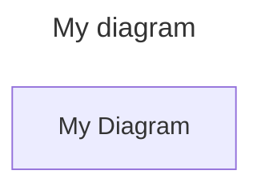

## 098 Mermaid CLI (AI, Research and Media-native) hint=github.com/mermaid-js/mermaid-cli 

[S1] https://github.com/mermaid-js/mermaid-cli (official)
### Mermaid with custom title/desc

You can easily pipe input from stdin. This example shows how to use a heredoc to send a diagram as stdin to mermaid-cli (mmdc).
cat << EOF | mmdc --input -
 graph TD
 A[Client] --> B[Load Balancer]
EOFmmdc -hdocker pull minlag/mermaid-cli
or pull from Github Container Registry
docker pull ghcr.io/mermaid-js/mermaid-cli/mermaid-cli
or e.g. version 8.8.0
docker pull minlag/mermaid-cli:8.8.0
The container looks for input files in /data. So for example, if you have a
diagram defined on your system in /path/to/diagrams/diagram.mmd, you can use
the container to generate an SVG file as follows:
docker run --rm -u `id -u`:`id -g` -v /path/to/diagrams:/data minlag/mermaid-cli -i diagram.mmd
Or, if using Podman, instead do:
podman run --userns keep-id --user ${UID} --rm -v /path/to/diagrams:/data:z ghcr.io/mermaid-js/mermaid-cli/mermaid-cli -i diagram.mmd
The key differences in the podman command versus the docker command are:
- The addition of the --userns keep-id argument. This allows the container to keep the same UID as the current user's UID in the container namespace instead of mapping to a subuid

[S2] https://github.com/mermaid-js/mermaid-cli/blob/master/docs/linux-sandbox-issue.md (official)
(node:8281) UnhandledPromiseRejectionWarning: Error: Failed to launch chrome!
[0416/092218.828861:ERROR:zygote_host_impl_linux.cc(88)] Running as root without --no-sandbox is not supported. See https://crbug.com/638180.
(node:8191) UnhandledPromiseRejectionWarning: Error: Failed to launch chrome!
[0416/091938.210735:FATAL:zygote_host_impl_linux.cc(124)] No usable sandbox! Update your kernel or see https://chromium.googlesource.com/chromium/src/+/master/docs/linux_suid_sandbox_development.md for more information on developing with the SUID sandbox. If you want to live dangerously and need an immediate workaround, you can try using --no-sandbox.
First and foremost, you should not run as root and you should upgrade your Linux kernel to latest version.
But if you don't want to follow the advice above and just want to disable sandbox, here you go:
Create a puppeteer-config.json file:
{
 "args": ["--no-sandbox"]
}
And when you invoke mmdc:
mmdc -p puppeteer-config.json ...

[S3] https://github.com/noahsabaj/mermaid-cli (third-party)
# Scoop (Windows)
scoop bucket add mermaid https://github.com/noahsabaj/scoop-mermaid
scoop install mermaid# WinGet (Windows) — pending review on the official winget-pkgs repo
winget install NoahSabaj.Mermaid
All three are bumped on every release.
With the Rust toolchain, cargo install mermaid-cli works too, though crates.io can lag the newest tag. Every release also attaches prebuilt binaries and Linux .deb/.rpm packages.
Mermaid needs one model backend, either kind. Ollama covers local inference (models auto-pull) but is not required — a provider API key alone is enough, see Remote providers. Name a remote model once with mermaid --model anthropic/<model> and Mermaid remembers it.
mermaid doctor # Check model, tools, safety, and project instructions
mermaid # Start the full-screen terminal coding agent
Then ask for normal coding-agent work:
- "read the repo and tell me where the test runner lives"
- "find the bug in this failing test and fix it"
- "review the current branch for regressions"
Inside the TUI, use /help for grouped commands, /doctor for the session readiness report, /init to have the agent write an AGENTS.md, /usage for tokens and estimated cost, /context to inspect 

[S4] https://raw.githubusercontent.com/noahsabaj/mermaid-cli/main/docs/cli-reference.md (third-party)
```bash
mermaid                                         # Start fresh session
mermaid --continue                              # Resume the most recent session in this directory
mermaid --resume                                # Pick a past session from a searchable list
mermaid --model ollama/qwen3-coder:30b          # Ollama local (any installed model — `mermaid list`)
mermaid --model anthropic/<model>               # Anthropic (requires ANTHROPIC_API_KEY)
mermaid --model gemini/<model>                  # Gemini (requires GOOGLE_API_KEY)
mermaid --model openai/<model>                  # OpenAI (requires OPENAI_API_KEY)
mermaid --model groq/<model>                    # Groq (requires GROQ_API_KEY)
mermaid --model grok/grok-4.6                   # Grok (xAI) (requires XAI_API_KEY; alias xai/<model>)
mermaid --model nvidia/z-ai/glm-5.2             # NVIDIA NIM (requires NVIDIA_API_KEY)
mermaid --model cloudflare/@cf/zai-org/glm-5.2  # Cloudflare Workers AI (CLOUDFLARE_API_TOKEN + CLOUDFLARE_ACCOUNT_ID)
mermaid --reasoning high                        # Override default reasoning depth
mermaid --path /path/to/project                  # Run against a specific project directory
mermaid --

- The file tools treat paths inside them like project paths: no outside-the-project approval or
  Auto-mode review, edits are checkpointed, and writes go through the same symlink-confined
  helpers with the added directory as the root. A symlink inside one that points out of it does
  not count as inside, and neither does a path outside that symlinks in.
- `execute_command` with a `working_dir` inside one is not escalated.
- `--confine-fs` / `--sandbox` let shell commands write there ([sandbox.md](sandbox.md)).
- `read_only` mode still blocks writes everywhere; reads of an added directory are simply not
  external reads.
- Subagents get the same list, and `/doctor` and the model's session facts name them.

- `/safety [read_only|ask|auto|full_access]` (alias `/permission`) — show or set the session safety mode; Shift+Tab cycles it
- `/approvals`, `/approve <id>`, `/deny <id>`
- `/checkpoint <path...>`, `/checkpoints`, `/restore <id>`

- `/tasks`, `/task <id>`, `/pause <id>`, `/resume <id>`
- `/agents` — list background subagents, or kill one
- `/processes`, `/logs <id>`, `/stop <id>`, `/restart <id>`, `/open <target>`, `/ports`

[S5] https://mermaid.ai/docs/ai/mcp-server (third-party)
Mermaid MCP Server
The Mermaid MCP Server enables AI assistants to create, validate, and render Mermaid diagrams seamlessly, plus full integration with your Mermaid account for advanced diagram management. When you ask your AI assistant to create a flowchart, sequence diagram, or any other Mermaid diagram, this server handles the entire process automatically - from syntax validation to PNG generation, interactive playground links, and direct integration with your Mermaid projects.
The Mermaid MCP Server supports multiple transport modes, and every tool call requires authentication with a Mermaid account. Authentication is free — you can sign up for a free Mermaid account (the Basic tier) to get started. Authenticate automatically via OAuth 2.1 with Dynamic Client Registration (for clients that support OAuth discovery, such as VS Code, Cursor, and Antigravity via mcp-remote), or manually by pasting a Mermaid token into your client configuration. See Authentication Setup below for details on both options.
Available Transport Types:
- HTTP: https://mcp.mermaid.ai/mcp with "type": "http"
- SSE (Server-Sent Events): https://mcp.mermaid.ai/sse with "type": "sse"
Authentication: Every too

[S6] https://www.npmjs.com/package/@mermaidchart/cli (third-party)
CLI for interacting with https://MermaidChart.com, the platform that makes collaborating with Mermaid diagrams easy!
@mermaidcart/cli is tested to work with Node.JS v18.18.0 or later.
We recommend installation using npx
to automatically download, cache, and run @mermaidcart/cli, as it comes with
most Node.JS installations.
npx @mermaidchart/cli --help
npx @mermaidchart/cli <command>
Use --help to see options!
npx @mermaidchart/cli --help
@mermaidchart/cli allows you to easily sync local diagrams with your diagrams
on https://mermaidchart.com.
These local diagrams can either be stored in .mmd or .mermaid files, or
they can be stored within ```mermaid code blocks within .md
GFM markdown files.
Firstly, go to https://www.mermaidchart.com/app/user/settings and generate an
API key, which you can then setup by running:
npx @mermaidchart/cli login
link an existing Mermaid diagram to MermaidChart.com
You can link a local Mermaid diagram to MermaidChart using:
npx @mermaidchart/cli link ./path/to/my/mermaid-digram.mmd
This will add an id: xxxx-xxxxx-xxxxx field to your diagram's YAML frontmatter,
which points to the diagram on MermaidChart.com:

push local changes to MermaidChart.com
Once you've made some local changes, you can push your changes to MermaidChart.com
$ npx @mermaidchart/cli push ./path/to/my/mermaid-digram.mmd
✅ - ./path/to/my/mermaid-digram.mmd was pushed
pull changes from MermaidChart.com
You can use pull to pull down changes from MermaidChart.com.
$ npx @mermaidchart/cli pull ./path/to/my/mermaid-digram.mmd
✅ - ./path/to/my/mermaid-digram.mmd was updated
Or use the --check flag to throw an error if your local file would have been
updated:
$ npx @mermaidchart/cli pull ./path/to/my/mermaid-digram.mmd
❌ - ./path/to/my/mermaid-digram.mmd would be updated
For local development and testing, you can pnpm dev to run the CLI,
pnpm run lint to run linting, and pnpm test to run unit tests.

[S7] https://mermaid.ai/docs/guides/mermaid-api-skill (third-party)
Mermaid API skill
Ask your coding agent to check or draw a Mermaid diagram, and it does it for you through Mermaid API. With the mermaid-api skill installed, your agent can:
- Validate diagram code. When the code is invalid, the API reports the line and column where the parser stopped, and the agent fixes the code there and checks again.
- Render a diagram to an SVG, PNG or PDF file at the path you name.
- Show a diagram as ASCII text right in your terminal. See below.
- Repair invalid code with Mermaid AI. Send it a diagram that won’t parse and it returns a fixed version.
- Generate one or several diagrams from a description with Mermaid AI, optionally with rendered results.
- Browse and read your Mermaid Chart projects and stored diagrams.
- Create, update and share stored diagrams, then hand them to a person with an edit link or a sharing invitation.
Beta. Mermaid API and the skill are in beta. Fields, limits and the latest supported Mermaid version can change. Don’t build a production dependency on them.
Diagrams right in your terminal
Ask for a diagram as text and the agent prints it as ASCII art in the chat. You see the diagram where you’re working, with no file to open and n

[S8] https://api.mermaid.ai/v1/llms.txt (third-party)
# Mermaid API

> Hosted API that validates and renders Mermaid diagrams for programs: agents, LLM tool calls, CI pipelines and products. Beta: breaking changes are announced in the changelog, not versioned.

Every `/v1` and `/v2` call except the reference below needs an API key: `Authorization: Bearer <key>`. A missing, unknown, revoked or expired key is 401 with its own code (`ERR_KEY_MISSING`, `ERR_KEY_UNKNOWN`, `ERR_KEY_REVOKED`, `ERR_KEY_EXPIRED`); fix the key, do not retry.

Personal keys can list their owner's Mermaid Chart projects with `GET /v1/projects`, list stored diagrams with `GET /v1/projects/{projectID}/diagrams`, and read one with `GET /v1/diagrams/{diagramID}`, free. Create with `POST /v1/diagrams`, update with `PUT /v1/diagrams/{diagramID}`, and share with `POST /v1/diagrams/{diagramID}/share`: the `store` class costs 1 API credit initially, charged only on success; invalid stored-diagram code is uncharged. Organisation keys cannot call these endpoints.

Every response carries an `x-request-id` header to quote when reporting a problem. Every non-2xx response body is `{ "error": { "code", "message", "details"? } }` with a stable, group-prefixed code.

## Reference

- [OpenAPI document](https://api.mermaid.ai/v1/openapi.json): the machine-readable contract, OpenAPI 3.1; its description is the guide: authentication, Mermaid config rules, response headers, the render cache, limits with every endpoint's cost in API credits, size and deadline limits, the beta notice, the changelog, curl examples. Each keyed operation carries its cost as `x-cost`; `GET /v1/balance` answers what remains and every cost, free
- [Reference page](https://api.mermaid.ai/v1/docs): the same document rendered for people
- [Error reference](https://api.mermaid.ai/v1/errors.json): every stable error code with its HTTP status and meaning, JSON
